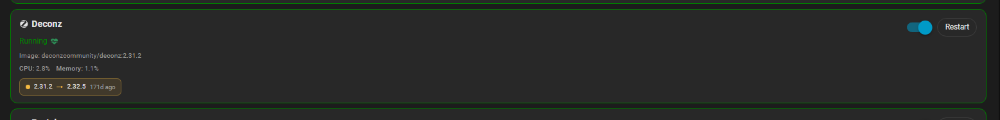

# Docker Card Extended
An extended version of Docker Card, inspired by [vineetchoudhary/lovelace-docker-card](https://github.com/vineetchoudhary/lovelace-docker-card), that lets you view and control your Docker containers from Home Assistant.


## Contents
- [Features](#features)
- [How it works](#how-it-works)
- [Requirements](#requirements)
- [Installation](#installation)
- [Quick start](#quick-start)
- [Importing containers from Portainer](#importing-containers-from-portainer)
- [Configuration options](#configuration-options)
- [Pause / Resume](#pause--resume)
- [Recreate container](#recreate-container)
- [Resource graphs (CPU / Memory)](#resource-graphs-cpu--memory)
- [Network I/O graphs](#network-io-graphs)
- [WUD integration](#wud-integration)
- [Full example configuration](#full-example-configuration)
- [Styling](#styling)
- [Without Portainer](#without-portainer)
- [Troubleshooting](#troubleshooting)
- [Changelog](#changelog)
- [Development](#development)
- [License](#license)

## Features
- **Visual editor** — set up the card from the dashboard UI: shared settings at the top, then add containers one at a time. Options the editor doesn't show stay in YAML and are preserved
- Compact overview of your Docker host (container counts, Docker version, OS, daemon state)
- Auto-updating container list with live state badges and control actions
- Collapsible container section
- Responsive multi-column layout that adapts to screen size — set `columns: 3` for three columns on wide screens, automatically reduces on smaller screens
- Per-container icons, health status indicators, and image version display
- **Pause / Resume support** — pause and resume individual containers directly from the card; paused containers are highlighted in amber and the toggle switch is automatically disabled to prevent invalid state transitions
- **Recreate container** — pull-and-recreate a container via Portainer's own button entity, with an "are you sure?" step first
- **CPU / Memory sparkline graphs** — opt-in full-width history graphs per container with an adaptive time axis and day breaks, rendered as lightweight inline SVG from the Home Assistant history API; no extra dependencies
- **WUD update tracking** — shows available updates with current → new version, how many days it's been available, and an optional release notes link (requires a running [What's Up Docker](https://github.com/getwud/wud) instance and the [WUD Monitor](https://github.com/johro897/wud-monitor) HA integration)
- **WUD check-failed indicator** — surfaces WUD's own reported error for a container (registry rate limit, auth failure) directly in the card instead of failing silently (requires WUD Monitor 2.2+)
- **WUD overview tiles** — shows last scan time and a one-click Force Scan button directly in the card overview
- **Prune unused images** — one-click prune of unused Docker images via Portainer's own button entity, with an inline confirmation step before it runs
- **Disk usage overview tiles** — container, image, and volume disk usage from Portainer, shown in whatever unit the sensor reports
- **Multi-language UI** — auto-translates to your Home Assistant language: English (default), Swedish, German, French
- Theme-aware styling with configurable running / paused / not-running accent colors
- Works out-of-the-box with entities from the Portainer integration; also supports any toggle-friendly domain (`switch`, `input_boolean`, `light`, etc.)
- Optional tap/hold actions per container row for quick navigation, service calls, or external links

## How it works
> [!IMPORTANT]
> **The card itself does not discover anything while it runs — not even from Portainer.** It has no Docker socket access and never talks to Docker or Portainer directly. Instead, the container list in your card configuration says exactly which Home Assistant entity represents each container's status, its start/stop switch, and so on, and the card simply displays and reacts to those entities. You can write that list by hand in YAML, or let the visual editor's **Import from Portainer** fill it in once (see [Importing containers](#importing-containers-from-portainer)) — the result is the same explicit list, which you can then edit.
>
> If the Portainer integration is installed and running but you haven't added anything under `containers:` yet, the card will correctly show **"No containers configured."** — that message means exactly what it says: no YAML list, no containers shown. It is not an error and does not mean anything is broken. See [Quick start](#quick-start) below to add your first container.

This indirection is deliberate: it's what lets the same card work with Portainer, with plain `command_line` sensors ([see Without Portainer](#without-portainer)), or with any other integration that exposes container state as entities — the card doesn't care where an entity comes from, only that it exists.

One consequence worth knowing up front: **entity IDs are generated by whichever integration provides them, not by this card**, and their exact names depend on your setup. If your Home Assistant instance runs in a language other than English, integrations that generate entity IDs from device/container names (Portainer included) may produce different, localized IDs than the English examples shown in this README. Always confirm your *actual* entity IDs in **Developer Tools → States** (filter by `docker` or your container's name) rather than assuming the examples below match your instance verbatim.

## Requirements
- Home Assistant 2025.8 or newer
- Docker managed via the official Portainer integration (provides all referenced sensors, switches, and buttons)
- **Optional but recommended:** A running [What's Up Docker (WUD)](https://github.com/getwud/wud) instance (tested with WUD 8.2+ and WUD 9.x) with the [WUD Monitor](https://github.com/johro897/wud-monitor) HA integration installed — required for update tracking and scan controls
- Optional: For non-Portainer environments, equivalent entities (sensors, binary_sensors, switches, scripts, etc.) that expose Docker data and operations

## Installation
### 1. Via HACS (recommended)
Docker Card Extended is available directly in the HACS default catalog. Search for **Docker Card Extended** under **Frontend** in HACS and install it — no custom repository needed.

[](https://my.home-assistant.io/redirect/hacs_repository/?owner=johro897&repository=docker-card-extended&category=dashboard)

### 2. Manual install
1. Copy `docker-card.js` to `/config/www/docker-card-extended/docker-card.js`
2. Add the resource via **Settings → Dashboards → Resources → +**:
   ```yaml
   url: /local/docker-card-extended/docker-card.js
   type: module
   ```
3. Hard-refresh your browser (`Ctrl/Cmd + Shift + R`)

## Quick start
This walks through the minimum needed to see one real container on the card. It assumes you've already completed [Installation](#installation) above.

1. **Install the Portainer integration**, if you haven't already: **Settings → Devices & Services → + → Portainer**.
2. **Find your actual entity IDs.** Go to **Developer Tools → States** and filter for one container you want to show, e.g. type its name in the filter box. You're looking for at minimum:
   - a **sensor** entity for its status (state values like `running` / `exited` / `paused`) — this becomes `status_entity`
   - a **switch** entity to start/stop it — this becomes `control_entity`

   > [!NOTE]
   > The exact names depend on your setup and language — see [How it works](#how-it-works). Don't skip this step and paste the examples below verbatim; confirm the real IDs first.
3. **Add the card** to a dashboard (**Edit Dashboard → Add Card → Manual**) with a minimal `containers:` list, substituting the entity IDs you just found:
   ```yaml
   type: custom:docker-card
   containers:
     - name: Home Assistant
       status_entity: sensor.home_assistant_state
       control_entity: switch.home_assistant_container
   ```
   Prefer clicking over YAML? Add the card from the dashboard's card picker and use the **visual editor** instead: set the shared options at the top, then press **Add container** for each container and pick its entities. Anything the editor doesn't show (colors, state lists, tap/hold actions, domain overrides) stays in the YAML and is kept as is. Saving from the editor writes the list as `containers:` (an older singular `container:` key is converted).
4. **Save.** You should now see one container row with a live status badge and a toggle. If you instead see **"No containers configured."**, double-check that the `containers:` list above was actually saved as part of the card's YAML (see [Troubleshooting](#troubleshooting)).
5. From here, add more entries to `containers:` for your other containers, and optionally add a `docker_overview:` block for the host-level summary tile — see [Configuration options](#configuration-options) for everything available, or jump to [Pause / Resume](#pause--resume), [Resource graphs](#resource-graphs-cpu--memory), and [WUD integration](#wud-integration) for the deeper features.

### Visual editor
Add the card from the dashboard's card picker and the editor opens. From top to bottom:

1. **Card settings:** title, maximum columns, expand-on-load and the graph defaults
2. **Docker overview** (collapsed): the host-level entities
3. **Containers:** press **Add container** for each one. Every row has its main entities (name, icon, status, start/stop, restart, pause, resume, CPU, memory) and an **Advanced** section (recreate, network RX/TX, image version, health, WUD update, graph overrides). Rows can be moved up and down or removed
4. **Import from Portainer** (see below) fills the same rows for you

Colors, state lists, tap/hold actions, domain overrides and the per-container `graphs` switch are not shown in the editor; they stay in YAML and are kept as they are when you edit. The editor writes the list as `containers:` (an older singular `container:` is converted). You can switch to the YAML editor at any time.

### Importing containers from Portainer
With the Portainer integration installed, the visual editor can build the container list for you. Open the card's editor, expand **Import from Portainer**, pick the endpoint, optionally type names to leave out (comma-separated, `*` and `?` allowed, e.g. `*-db, watchtower`), and press **Import containers**.

- It adds one row per container on that endpoint, sorted by name, with the entities Portainer provides (status, start/stop, restart, pause, resume, recreate, CPU, memory, image version, health). Portainer entities are recognised by their internal keys, so this works in any Home Assistant language
- It also fills **empty** `docker_overview` fields from the endpoint (status, counts, versions, disk usage, prune buttons)
- With [WUD Monitor](https://github.com/johro897/wud-monitor) installed, `update_entity` is filled in by matching container names, and `wud_last_poll` / `wud_scan` in the overview. If the same container name exists on two WUD watchers it is left blank rather than guessed. WUD Monitor releases that have the `container_name` attribute (wud-monitor #32) are matched on the exact name; older versions are matched on the entity name
- It **only adds**: containers already in the list (same status entity or name) and fields you have already set are never changed, so you can import again after adding containers in Portainer
- Containers that no longer exist in Portainer (their status entity is `unavailable`) are skipped
- Memory uses Portainer's percentage sensor, or the absolute one if the percentage sensor is not enabled

## Configuration options
### Card options
| Option | Required | Default | Description |
| --- | --- | --- | --- |
| `title` | No | `Docker Card` | Card header text |
| `containers_expanded` | No | `false` | Expand container list on load |
| `columns` | No | `1` | Maximum number of columns — reduces automatically on smaller screens |
| `running_color` | No | Theme value | Global accent color for running containers |
| `not_running_color` | No | Theme value | Global accent color for stopped containers |
| `paused_color` | No | `#f4b942` (amber) | Global accent color for paused containers |
| `graphs` | No | `false` | Show CPU/Memory history sparklines instead of plain text values — overridable per container |
| `graph_hours` | No | `2` | History window for graphs, in hours — overridable per container |
| `graph_height` | No | `34` | Graph height in pixels — overridable per container |
| `graph_refresh` | No | `300` | Minimum seconds between history refetches per entity — overridable per container (floor: `30`, lower values are raised automatically) |
| `graph_cpu_color` | No | `var(--primary-color)` | Line/area color for CPU graphs — overridable per container |
| `graph_memory_color` | No | `var(--accent-color)` | Line/area color for Memory graphs — overridable per container |
| `graph_network_rx_color` | No | `var(--info-color)` | Line color for the Network RX (download) line — overridable per container |
| `graph_network_tx_color` | No | `var(--warning-color)` | Line color for the Network TX (upload) line — overridable per container |
| `docker_overview` | No | — | High-level Docker host stats |
| `containers` | **Yes** | — | Array of container definitions |

### docker_overview options
| Option | Description |
| --- | --- |
| `status` | Binary sensor for overall Docker daemon state |
| `container_count` | Total number of containers |
| `containers_running` | Number of running containers |
| `containers_paused` | Number of paused containers — enables the expanded `running · paused · stopped` display |
| `containers_stopped` | Number of stopped containers — enables the expanded `running · paused · stopped` display |
| `docker_version` | Docker version string |
| `image_count` | Number of Docker images |
| `operating_system` | Host OS name |
| `operating_system_version` | Host OS version |
| `container_disk_usage` | Portainer sensor — total disk space used by containers. See note below if it stays `unknown`/`unavailable` |
| `image_disk_usage` | Portainer sensor — total disk space used by images. See note below if it stays `unknown`/`unavailable` |
| `volume_disk_usage` | Portainer sensor — total disk space used by volumes. See note below if it stays `unknown`/`unavailable` |
| `wud_last_poll` | WUD Monitor sensor — shows timestamp of last WUD scan |
| `wud_scan` | WUD Monitor button — click to trigger an immediate scan of all containers |
| `prune_images` | Portainer's "Prune unused images" button — removes unused Docker images from the endpoint. Asks for confirmation before running. Shares one tile with `wud_scan` *only* when it's the sole maintenance action configured (no `prune_volumes`/`prune_networks`) — with more than one maintenance action set, all of them (including this one) render as their own standalone tile, for consistency |
| `prune_volumes` | Portainer's "Prune unused volumes" button — same confirm-before-running flow as `prune_images`, in its own tile |
| `prune_networks` | Portainer's "Prune unused networks" button — same confirm-before-running flow as `prune_images`, in its own tile |
| `updates_summary` | Add an aggregate "N updates available" tile, counting containers with a pending WUD update. Hidden when the count is `0` |

> [!NOTE]
> **If `container_disk_usage` / `image_disk_usage` / `volume_disk_usage` stay stuck on `unknown` — or show as `unavailable` entirely — this is a known Portainer/Home Assistant limitation, not a card bug.** These sensors are populated via Docker's `docker system df` command, which is [documented to be slow on overlay2 filesystems](https://github.com/home-assistant/core/issues/165617) — common on Linux and NAS Docker hosts. If it exceeds the integration's timeout, those specific sensors either stay `unknown` or are marked `unavailable` outright (both outcomes are reported against the same upstream issue), while the rest of the integration keeps working normally. Home Assistant closed the upstream issue as "not planned," so there's currently no fix on their side either. You can confirm this is the cause by running `time docker system df` on your Docker host — if it takes more than a few seconds, that's why.

### Container options
| Option | Required | Description |
| --- | --- | --- |
| `name` | No | Display name (defaults to entity friendly name) |
| `icon` | No | MDI icon, e.g. `mdi:home-assistant` |
| `status_entity` | Preferably | Entity whose state represents container status — use a `sensor`, not a `binary_sensor`, to get text states like `running`, `paused`, `stopped` |
| `control_entity` | Conditional | Entity supporting `turn_on`/`turn_off` to start/stop the container |
| `control_domain` | No | Override domain for `control_entity` |
| `restart_entity` | No | Entity to trigger a restart (`button`, `switch`, `script`, etc.) |
| `restart_domain` | No | Override domain for `restart_entity` |
| `pause_entity` | No | Entity to trigger a pause (`button`, `script`, `automation`) |
| `resume_entity` | No | Entity to trigger a resume (`button`, `script`, `automation`) |
| `recreate_entity` | No | Portainer's recreate-container entity (`button`, `script`, `automation`). Asks for confirmation before running — see [Recreate container](#recreate-container) |
| `cpu_entity` | No | Sensor for CPU usage. Displayed in whatever unit the sensor itself declares (`%` if none is set) |
| `memory_entity` | No | Sensor for memory usage — percentage or an absolute unit like `MB`/`GB`. Displayed in whatever unit the sensor itself declares (`%` if none is set) |
| `graphs` | No | Per-container override of the card-level `graphs` setting (`true`/`false`) |
| `graph_hours` | No | Per-container history window in hours |
| `graph_height` | No | Per-container graph height in pixels |
| `graph_refresh` | No | Per-container minimum seconds between history refetches |
| `graph_cpu_color` | No | Per-container override for CPU graph color |
| `graph_memory_color` | No | Per-container override for Memory graph color |
| `network_rx_entity` | No | Sensor for network download (RX) throughput. Configure with `network_tx_entity` for a two-line graph, or on its own for a single-line one — see [Network I/O graphs](#network-io-graphs) |
| `network_tx_entity` | No | Sensor for network upload (TX) throughput — see [Network I/O graphs](#network-io-graphs) |
| `graph_network_rx_color` | No | Per-container override for the Network RX line color |
| `graph_network_tx_color` | No | Per-container override for the Network TX line color |
| `image_version_entity` | No | Sensor showing the current image tag/version |
| `health_entity` | No | Sensor for container health (`healthy`, `unhealthy`, `starting`) |
| `update_entity` | No | WUD Monitor sensor for update tracking — requires WUD + WUD Monitor integration |
| `running_color` | No | Per-container override for running accent color |
| `not_running_color` | No | Per-container override for stopped accent color |
| `paused_color` | No | Per-container override for paused accent color |
| `running_states` | No | Custom list of states that count as "running" |
| `stopped_states` | No | Custom list of states that count as "stopped" |
| `paused_states` | No | Custom list of states that count as "paused" (default: `["paused", "pause"]`) |
| `tap_action` | No | Action on row tap (standard Lovelace action object) |
| `hold_action` | No | Action on long-press |
| `hold_delay` | No | Hold detection delay in ms (default: `500`) |
| `switch_entity` | No | Legacy alias for `control_entity` |

> **Tip:** `binary_sensor` entities only report `on` or `off` and cannot represent a `paused` state. Always use a `sensor` for `status_entity` if you need pause detection or accurate stopped/running text states.

Color values fall back to Home Assistant theme variables (`var(--state-active-color)`, `var(--state-error-color)`) when omitted. The legacy key `stopped_color` still maps to `not_running_color`, and `switch_domain` still maps to `control_domain`, for backward compatibility.

## Pause / Resume
Containers can be paused and resumed directly from the card without stopping them. When a container is paused:
- The row border and status text turn **amber**
- The toggle switch is **disabled** — start/stop is not available while paused
- The **Pause** button changes to **Resume**

Add `pause_entity` and `resume_entity` to a container pointing to the corresponding Portainer buttons:
```yaml
containers:
  - name: Uptime Kuma
    status_entity: sensor.uptime_kuma_state
    control_entity: switch.uptime_kuma_container
    pause_entity: button.uptime_kuma_pause_container
    resume_entity: button.uptime_kuma_resume_container
    restart_entity: button.uptime_kuma_restart_container
    icon: mdi:timeline-plus
```
The Pause / Resume button is only shown when the container is **running** or **paused** — it is hidden for stopped containers.

### Overview — Running · Paused · Stopped
When `containers_paused` and/or `containers_stopped` are configured in `docker_overview`, the running tile expands to show a full breakdown:
```
2 running · 1 paused · 3 stopped
```
Without those sensors the tile falls back to the compact `running / total` format.

## Recreate container
Portainer's own [`button.*_recreate`](https://www.home-assistant.io/integrations/portainer) entity recreates a container by pulling the image at whatever tag it's already configured with. Add `recreate_entity` to a container and a **Recreate** button appears next to Restart:
```yaml
containers:
  - name: Home Assistant
    status_entity: sensor.home_assistant_state
    control_entity: switch.home_assistant_container
    recreate_entity: button.portainer_home_assistant_recreate
```
Like Prune, clicking **Recreate** doesn't fire immediately — it swaps to an inline "Recreate container?" confirmation with **Confirm** / **Cancel** before calling the service.

> [!IMPORTANT]
> **Only meaningful on mutable tags.** The button re-pulls the exact tag the container already uses — it does not change tags for you. A container pinned to a fixed version like `:1.4.2` will just re-pull the same image, effectively a no-op. Recreate only has a real effect on rolling tags like `:latest` or `:stable`, where the registry may have re-pointed the tag to a newer image since the container was created.

## Resource graphs (CPU / Memory)
Set `graphs: true` to replace the plain CPU/Memory text with mini sparkline graphs per container. The graphs span the full width of the card row, below the name and action buttons, and each one shows the sensor's recent history, a time axis, and the current live value:
```yaml
type: custom:docker-card
graphs: true          # enable for the whole card
graph_hours: 6        # history window in hours (default: 2)
graph_height: 34      # graph height in px (default: 34)
graph_refresh: 300    # seconds between history refetches (default: 300)
containers:
  - name: Home Assistant
    status_entity: sensor.home_assistant_state
    control_entity: switch.home_assistant_container
    cpu_entity: sensor.home_assistant_cpu_usage
    memory_entity: sensor.home_assistant_memory_usage
    graph_hours: 48   # this one gets a longer window
    graph_height: 48
  - name: Deconz
    status_entity: sensor.deconz_state
    control_entity: switch.deconz_container
    cpu_entity: sensor.deconz_cpu_usage
    memory_entity: sensor.deconz_memory_usage
    graphs: false     # no graphs for this container
```
> [!TIP]
> **Every `graph_*` option can be set both card-wide and per container** — `graphs`, `graph_hours`, `graph_height`, `graph_refresh`, `graph_cpu_color` and `graph_memory_color`. The container value always wins, so you can keep a short default window for the card and give a few noisy containers a longer one.

### Time axis
Each graph has a time axis underneath that adapts to the window length:
| Window | Axis |
| --- | --- |
| Less than a day | Clock times (start · middle · end) with a gridline at the midpoint |
| Spanning 1–6 midnights | A dashed gridline at every local midnight, with the weekday label pinned to it |
| More than a week | Three labels showing date + time (e.g. `29 Jul 14:00`) |

Times and dates follow your Home Assistant language setting.

### How the graphs work
- History is fetched from the Home Assistant REST history API (`minimal_response`, `no_attributes`) and cached per entity **and** window, so containers with different `graph_hours` never overwrite each other's data
- The card re-renders on every state change in HA, but the API is never called more often than `graph_refresh` (stale-while-revalidate). Changing a window in the YAML clears the cache immediately
- The current sensor state is always appended as the last point, so the graph never lags behind the displayed value
- Series are downsampled to at most 120 points per graph to keep the DOM light
- Graphs are pure inline SVG — no external chart libraries
- CPU and Memory sit side by side when the row is wide enough and stack automatically on narrow screens

**Colors** default to `var(--primary-color)` for CPU and `var(--accent-color)` for Memory. Override globally with `graph_cpu_color` / `graph_memory_color`, or per container with the same keys.

> [!NOTE]
> The `cpu_entity` / `memory_entity` sensors must be included in the [recorder](https://www.home-assistant.io/integrations/recorder/) — excluded entities have no history and the graph shows *no history* (the current value is still displayed). The axis reflects the data that actually exists, so a graph can be shorter than the window you asked for if the recorder has nothing older. With `graphs` omitted or `false`, the card behaves exactly as before.

## Network I/O graphs
Unlike CPU/Memory, network throughput has a direction — download (RX) and upload (TX) — so which line(s) you get is controlled purely by which sensors you configure:
```yaml
graphs: true
containers:
  - name: plex
    status_entity: sensor.plex_status
    control_entity: switch.plex
    network_rx_entity: sensor.plex_network_rx    # optional on its own
    network_tx_entity: sensor.plex_network_tx    # optional on its own
```
- Only `network_rx_entity` (or only `network_tx_entity`) set → a single-line graph, same look as CPU/Memory
- Both set → one graph with two lines sharing a y-scale, labeled `↓ <value>` / `↑ <value>` in their own colors — no area fill, so the two lines stay readable where they cross

**Colors** default to `var(--info-color)` for RX and `var(--warning-color)` for TX. Override globally with `graph_network_rx_color` / `graph_network_tx_color`, or per container with the same keys.

> [!NOTE]
> Same recorder requirement and `graphs: true` gate as CPU/Memory graphs above — network sensors aren't shown at all outside graph mode.

## WUD integration
To use WUD update tracking and scan controls you need:
1. A running [What's Up Docker](https://github.com/getwud/wud) instance (tested with WUD 8.2+ and WUD 9.x)
2. The [WUD Monitor](https://github.com/johro897/wud-monitor) integration installed in Home Assistant
3. Each container in WUD labelled with `wud.watch: "true"` in its `docker-compose.yml`

### Per-container update badge
> [!TIP]
> If you build the container list with the editor's [Import from Portainer](#importing-containers-from-portainer), `update_entity`, `wud_last_poll` and `wud_scan` are filled in for you when WUD Monitor is installed. Containers are matched by name; WUD Monitor releases with the `container_name` attribute match exactly, older ones by entity name. A container name that exists on two WUD watchers is left blank.

Add `update_entity` to a container pointing to its WUD Monitor sensor:
```yaml
containers:
  - name: ESPHome
    status_entity: sensor.esphome_state
    control_entity: switch.esphome_container
    update_entity: sensor.esphome_update_available
    icon: mdi:chip
```
When an update is available the card shows an inline badge with current → new version and how many days it has been available.



> [!NOTE]
> **Requires WUD Monitor 2.2+:** if the container has a `wud.link.template` label configured in WUD (see [WUD Monitor's README](https://github.com/johro897/wud-monitor#wud-container-labels)), a small link icon appears in the badge linking to the release notes. And if WUD itself fails to check a container — a registry rate limit, an auth failure — the same badge slot shows that error in red instead of staying silent about it. Both are read from the `update_entity` sensor's `release_notes` and `error` attributes; on older WUD Monitor versions neither attribute exists and the badge renders exactly as before.

### Overview tiles — Last scan & Force Scan
Add `wud_last_poll` and `wud_scan` to `docker_overview` to show the last scan timestamp and a one-click scan button alongside your other overview stats:
```yaml
docker_overview:
  containers_running: sensor.docker_containers_running
  container_count: sensor.docker_containers_total
  wud_last_poll: sensor.wud_wud_last_poll
  wud_scan: button.wud_wud_force_scan_all
```
Clicking **Scan now** calls `button.press` on the WUD Monitor Force Scan button. The tile shows "Scanning…" for 3 seconds while the action completes.

> [!NOTE]
> Without the WUD Monitor integration, `update_entity`, `wud_last_poll`, and `wud_scan` have no effect — the rest of the card works normally.

### Prune unused images
Portainer's own [`button.*_prune_images`](https://www.home-assistant.io/integrations/portainer) entity removes unused Docker images from the endpoint. Add it as `prune_images` in `docker_overview`:
```yaml
docker_overview:
  wud_scan: button.wud_wud_force_scan_all
  prune_images: button.portainer_local_prune_images
```
When both `wud_scan` and `prune_images` are set — and `prune_images` is the *only* maintenance action configured — they share one overview tile, split by a divider. Add `prune_volumes` and/or `prune_networks` (see below) and the sharing stops: every maintenance action, `prune_images` included, then gets its own standalone tile, so you don't end up with one action singled out into a shared tile while the others sit apart.

Clicking **Prune now** doesn't fire immediately — it swaps to an inline "Remove unused images?" confirmation with **Confirm** / **Cancel**, since this is a destructive action. Confirming calls `button.press` on the configured entity and shows "Pruning…" for 3 seconds.

Pairs well with `image_disk_usage` in `docker_overview` — watch the number drop after a prune.

> [!WARNING]
> **Pruning may silently leave tagged-but-unused images behind — this is a known Portainer integration bug, not a card bug.** [home-assistant/core#179542](https://github.com/home-assistant/core/issues/179542) confirms the integration's `prune_images` action doesn't correctly pass its `dangling: false` filter to Portainer's API — calling Portainer's own API directly with the same parameters prunes correctly, so the bug is in the integration, not Portainer or this card. No fix as of this writing. If images you expect to be removed remain after pruning, this is why.

Portainer also exposes `button.*_prune_volumes` and `button.*_prune_networks` entities — add them as `prune_volumes` / `prune_networks` in `docker_overview` for the same confirm-before-running flow. Each renders in its own standalone tile; configuring any of them alongside `prune_images` also moves `prune_images` out of the shared WUD tile (see above), so all maintenance actions stay consistent with each other:
```yaml
docker_overview:
  prune_images: button.portainer_local_prune_images
  prune_volumes: button.portainer_local_prune_volumes
  prune_networks: button.portainer_local_prune_networks
```

> [!WARNING]
> **`prune_volumes` may fail outright with "An error occurred while trying to connect to the Portainer instance" — a separate, unrelated suspected Portainer integration issue from the tagged-images bug above, not confirmed as a card bug.** Where the images bug above prunes *silently incompletely*, this one is a hard failure on every attempt. The card's Confirm button calls the exact same `button.press` service call as `prune_images`/`wud_scan`, both of which work reliably, and Portainer's own data coordinator keeps polling successfully in the same log window — so this isn't a real connectivity problem. Comparing the underlying [`pyportainer`](https://github.com/erwindouna/pyportainer) library's `prune_volumes()` against the already-working `images_prune()` shows one concrete difference: `prune_volumes` sends a redundant `endpointId` query parameter (the endpoint ID is already in the URL path) alongside `all`, which `images_prune` doesn't do. That's a plausible cause, but unconfirmed — Home Assistant's generic error message swallows the actual underlying exception. If you hit this, the button press itself and this card are not the problem.

## Full example configuration
Everything above, combined into one card:
```yaml
type: custom:docker-card
title: Docker @ MyServer
containers_expanded: true
columns: 3
graphs: true
graph_hours: 6
docker_overview:
  status: binary_sensor.docker_daemon_status
  container_count: sensor.docker_containers_total
  containers_running: sensor.docker_containers_running
  containers_paused: sensor.docker_containers_paused
  containers_stopped: sensor.docker_containers_stopped
  docker_version: sensor.docker_version
  image_count: sensor.docker_images
  operating_system: sensor.host_os
  operating_system_version: sensor.host_os_version
  container_disk_usage: sensor.portainer_local_container_disk_usage
  image_disk_usage: sensor.portainer_local_image_disk_usage
  volume_disk_usage: sensor.portainer_local_volume_disk_usage
  wud_last_poll: sensor.wud_wud_last_poll
  wud_scan: button.wud_wud_force_scan_all
  prune_images: button.portainer_local_prune_images
running_color: "var(--state-active-color)"
not_running_color: "#c22040"
paused_color: "#f4b942"
containers:
  - name: Home Assistant
    status_entity: sensor.home_assistant_state
    control_entity: switch.home_assistant_container
    restart_entity: button.home_assistant_restart_container
    pause_entity: button.home_assistant_pause_container
    resume_entity: button.home_assistant_resume_container
    recreate_entity: button.portainer_home_assistant_recreate
    cpu_entity: sensor.home_assistant_cpu_usage
    memory_entity: sensor.home_assistant_memory_usage
    image_version_entity: sensor.home_assistant_image
    health_entity: sensor.docker_home_assistant_health
    icon: mdi:home-assistant
    tap_action:
      action: more-info
      entity: sensor.home_assistant_state
  - name: ESPHome
    status_entity: sensor.esphome_state
    control_entity: switch.esphome_container
    restart_entity: button.esphome_restart_container
    pause_entity: button.esphome_pause_container
    resume_entity: button.esphome_resume_container
    update_entity: sensor.esphome_update_available
    icon: mdi:chip
  - name: Deconz
    status_entity: sensor.deconz_state
    control_entity: switch.deconz_container
    restart_entity: button.deconz_restart_container
    pause_entity: button.deconz_pause_container
    resume_entity: button.deconz_resume_container
    cpu_entity: sensor.deconz_cpu_usage
    memory_entity: sensor.deconz_memory_usage
    image_version_entity: sensor.deconz_image
    health_entity: sensor.docker_deconz_health
    update_entity: sensor.deconz_update_available
    icon: mdi:zigbee
```

## Styling
- **Accent colors:** Set `running_color`, `not_running_color`, and `paused_color` globally or per-container to highlight critical services
- **Running · Paused · Stopped indicator:** The overview tile automatically switches to a full breakdown when `containers_paused` or `containers_stopped` sensors are configured — handy for spotting issues at a glance
- **Resource graphs:** Tune `graph_height` and the `graph_*_color` options to match your theme; graphs inherit the card background and divider colors automatically
- **Theme alignment:** The card inherits typography, spacing, and background from your active Home Assistant theme

## Without Portainer
The editor's import only knows the Portainer integration; without it, add containers one at a time in the editor or in YAML. If you don't use the Portainer integration, you can expose Docker data using `command_line` sensors and `shell_command` helpers:
```yaml
sensor:
  - platform: command_line
    name: docker_containers_total
    command: "docker info --format '{{.Containers}}'"
    scan_interval: 60
  - platform: command_line
    name: docker_containers_running
    command: "docker info --format '{{.ContainersRunning}}'"
    scan_interval: 60
  - platform: command_line
    name: docker_version
    command: "docker version --format '{{.Server.Version}}'"
    scan_interval: 3600
  - platform: command_line
    name: docker_homeassistant_status
    command: "docker inspect -f '{{.State.Status}}' homeassistant"
    scan_interval: 30
switch:
  - platform: command_line
    switches:
      docker_homeassistant:
        friendly_name: Docker Home Assistant
        command_on: "docker start homeassistant"
        command_off: "docker stop homeassistant"
        command_state: "docker inspect -f '{{.State.Running}}' homeassistant"
        value_template: "{{ value == 'true' or value == 'running' }}"
button:
  - platform: template
    buttons:
      docker_restart_homeassistant:
        name: Restart Home Assistant container
        press:
          service: shell_command.docker_restart_homeassistant
shell_command:
  docker_restart_homeassistant: "docker restart homeassistant"
```

## Troubleshooting
| Problem | Solution |
| --- | --- |
| Card shows "No containers configured." | This is expected, not an error — it means the card has an empty or missing `containers:` list. See [How it works](#how-it-works) and [Quick start](#quick-start): this card never auto-discovers containers, even with Portainer installed. Add at least one entry under `containers:` in the card's YAML. |
| Custom card not found | Verify the resource URL is registered and hard-refresh the browser |
| Entities missing | Check that the Portainer integration is connected and entity IDs match your YAML — confirm the *exact* IDs in Developer Tools → States, especially on non-English Home Assistant instances (see [How it works](#how-it-works)) |
| Import from Portainer says "No Portainer endpoint found" | The editor lists devices from the Portainer integration whose model is *Endpoint*. Check **Settings → Devices & services → Portainer** that the integration is loaded and its endpoint device exists and is enabled |
| Import added a container but `update_entity` is empty | WUD Monitor is not installed, the container is not in WUD, the name differs between Portainer and WUD, or the same name exists on two WUD watchers (left blank on purpose). Set `update_entity` by hand, or update WUD Monitor to a release with the `container_name` attribute |
| Import skipped containers I expected | Containers whose status entity is `unavailable` (gone from Portainer) are skipped, as are names matching your exclude patterns |
| Colors not updating | Reload the dashboard after changing color values; check for typos in CSS variables or hex codes |
| Toggle not working | Ensure `control_entity` uses a supported domain (`switch`, `input_boolean`, etc.) — `binary_sensor` is read-only |
| Container stopped/started but the card doesn't update right away | The card re-renders as soon as `status_entity`'s state actually changes in `hass.states` — if it lags, the delay is on Portainer's side (it polls the Docker daemon rather than reacting instantly), not the card. Check **Developer Tools → States** for the same entity: if it's slow to update there too, this is expected Portainer integration behavior, not a card bug |
| Paused state not detected | Use a `sensor` (not `binary_sensor`) for `status_entity`; verify the entity reports `paused` as its state in Developer Tools → States |
| Pause button missing | The button only appears when the container is running or paused — it is hidden for stopped containers |
| Pause / Resume not working | Check that `pause_entity` and `resume_entity` point to valid `button.*` entities and that they exist in Developer Tools |
| Graphs not showing | Set `graphs: true` (card-level or per-container) and make sure the container has `cpu_entity` / `memory_entity` configured |
| Graph shows "no history" | The sensor is excluded from the recorder or has no recorded data yet — check **Developer Tools → Statistics** / your `recorder:` include/exclude rules |
| Graph shorter than `graph_hours` | The recorder has no older data for that sensor. Check `purge_keep_days` and your `recorder:` filters, and compare with the sensor's own history panel — if HA can't show the range, the card can't either |
| Changed `graph_hours`, nothing happened | Hard-refresh the browser (`Ctrl/Cmd + Shift + R`). Also verify the option sits where you intended: on the card for a global default, or inside a container entry to override just that one |
| Update badge not showing | Verify WUD is running, the WUD Monitor integration is installed, and `update_entity` points to the correct sensor |
| Release notes link not showing | Requires WUD Monitor 2.2+, an update currently available, and a `wud.link.template` label configured on that container in WUD — see [WUD Monitor's README](https://github.com/johro897/wud-monitor#wud-container-labels) |
| Update badge shows a red error instead of a version | WUD itself failed to check that container (registry rate limit, auth failure, etc.) — this is WUD Monitor's `error` attribute, not a card issue. Check WUD's own logs/UI for the underlying cause |
| Scan button not working | Verify the WUD Monitor integration is installed and `wud_scan` points to the correct `button.*` entity |
| Prune button not working | Verify `prune_images` points to a valid Portainer `button.*_prune_images` entity and that the Portainer integration is connected |
| Pruning runs but tagged images stay behind | Known Portainer integration bug, not a card bug — see the warning in [Prune unused images](#prune-unused-images) ([home-assistant/core#179542](https://github.com/home-assistant/core/issues/179542)) |
| Prune Volumes fails with "error occurred while trying to connect to the Portainer instance" | A separate, unrelated suspected Portainer integration issue from the tagged-images bug above (this one is a hard failure, not silently incomplete pruning) — not a confirmed card bug. See the second warning under [Prune unused images](#prune-unused-images) |
| Recreate button missing | Add `recreate_entity` pointing to the container's Portainer recreate `button.*` entity |
| Recreate doesn't seem to update the container | Expected if the image tag is pinned (e.g. `:1.4.2`) — see the note in [Recreate container](#recreate-container). Only mutable tags like `:latest` actually change |
| Disk usage tiles stuck on "—" / entity shows `unknown` or `unavailable` | Known upstream Portainer/HA limitation, not a card bug — see the note under [docker_overview options](#docker_overview-options). `docker system df` is slow on overlay2 filesystems and can time out ([tracked upstream](https://github.com/home-assistant/core/issues/165617), closed as not planned) |

## Changelog

### 3.10.0
**Visual config editor** — [#26](https://github.com/johro897/docker-card-extended/issues/26)
- The card can now be configured from the dashboard UI. Shared settings (title, columns, expand on load, graph defaults) and the Docker overview entities are at the top; containers are added one at a time with **Add container**, each with its main entities and an **Advanced** section (recreate, network, image version, health, WUD update, graph overrides). Rows can be reordered and removed
- Options the editor does not show (colors, state lists, tap/hold actions, domain overrides, the per-container `graphs` switch) are never touched: they stay in YAML and are preserved when you edit
- The editor writes the container list as `containers:`; an older singular `container:` key is converted on the first change
- Labels are available in English, Swedish, German and French

**Import containers from a Portainer endpoint** — [#21](https://github.com/johro897/docker-card-extended/issues/21)
- New **Import from Portainer** section in the editor: pick an endpoint, optionally exclude names with `*`/`?` patterns, and it adds the endpoint's containers with their Portainer entities, plus empty `docker_overview` fields. WUD Monitor entities (`update_entity`, last scan, force scan) are matched by container name when WUD Monitor is installed
- Import only adds: existing containers and fields you have set are never overwritten. The card still discovers nothing while it runs; the result is the same explicit container list as before

### 3.9.0
**Network I/O graphs** — [#19](https://github.com/johro897/docker-card-extended/issues/19)
- New `network_rx_entity` / `network_tx_entity` per-container options — configure one for a single-line graph, or both for a two-line RX/TX graph sharing a y-scale
- New `graph_network_rx_color` / `graph_network_tx_color` options (card-level and per-container), defaulting to `var(--info-color)` / `var(--warning-color)`
- Works standalone — `graphs: true` no longer requires `cpu_entity`/`memory_entity` to also be configured

**Generalized the Prune confirm pattern to Volumes and Networks** — [#17](https://github.com/johro897/docker-card-extended/issues/17)
- New `prune_volumes` / `prune_networks` `docker_overview` options, reusing the same arm → inline confirm → pending flow as `prune_images` (#7)
- Each renders in its own standalone tile. `prune_images` keeps sharing a tile with `wud_scan` when it's the *only* maintenance action configured, same as before — but once `prune_volumes`/`prune_networks` are also set, `prune_images` moves out of the shared tile too, so every maintenance action is consistent with the others

**Aggregate updates overview tile** — [#16](https://github.com/johro897/docker-card-extended/issues/16)
- New opt-in `docker_overview.updates_summary: true` option adds an "N updates available" tile to the overview grid, counting containers whose `update_entity` currently reports an available update
- Off by default; the tile is also hidden automatically when the count is `0`, so it never adds noise when everything is up to date

**Fix: language auto-detection was silently broken** — [#22](https://github.com/johro897/docker-card-extended/issues/22)
- The card had a full translation mechanism, but it was built to fetch separate `translations/<lang>.json` files at runtime — HACS's plugin category only ever distributes the single file named in `hacs.json`, so those files never reached a real install and the card has only ever rendered English, regardless of your HA instance's language
- Fixed by bundling English, Swedish, German, and French directly in the card file, matching the pattern already used by this project's other five cards
- Also fixed the language-detection source: previously read `hass.selectedLanguage` (not a real HA frontend property) — now reads `hass.locale.language`/`hass.language`, matching every other translated card here

### 3.7
**Security hardening** — [#13](https://github.com/johro897/docker-card-extended/issues/13)
- The release-notes link now validates the URL scheme before rendering — only `http(s)` links are shown, blocking anything WUD could theoretically supply via a `javascript:`/`data:` value
- Container identifiers used in internal action attributes (start/stop, restart, pause/resume, recreate) are now HTML-escaped consistently with the rest of the card

**Performance: dirty-check in the `hass` setter** — [#14](https://github.com/johro897/docker-card-extended/issues/14)
- The card now only re-renders when something it actually watches (an overview entity or one of a container's configured entities) changes state or attributes — previously every single Home Assistant state change, anywhere in the install, triggered a full re-render of this card
- No visible behavior change; the card should feel the same, just lighter on larger installs and with graphs enabled

**Accessibility & theming** — [#15](https://github.com/johro897/docker-card-extended/issues/15)
- Keyboard focus is now restored to the Cancel button after arming the Prune/Recreate confirm step, and back to the original button after cancelling — previously the re-render dropped focus to the page body, and with #14 not yet applied the frequent re-renders could also drop focus mid-interaction
- Container rows with a `tap_action` now respond to Space, not just Enter, matching every other keyboard-operable control in the card
- The container start/stop toggle now has an `aria-label` naming both the action and the container, not just a `title` attribute
- The update badge and container health icon now use the same theme-variable colors as the rest of the card (`running_color`/`not_running_color`/`paused_color`) instead of fixed hex values
- Added `:focus-visible` outlines to the Prune/Recreate Confirm/Cancel buttons, Restart, Pause, Recreate, and the container toggle switch — this card renders into light DOM rather than a Shadow DOM like the rest of this project's cards, so it has no isolation from the dashboard theme's own focus handling and needed these explicitly

### 3.6
**Fix: `cpu_entity` / `memory_entity` now respect their own unit** — requested in #6
- Values and graph labels now use the sensor's own `unit_of_measurement` (e.g. `MB`, `GB`) instead of always appending `%`
- Falls back to `%` for sensors that don't declare a unit — no change for existing percentage-based setups
- The graphs themselves were already unit-agnostic (auto-scaled to the actual data); only the text label was hardcoded

**Prune unused images** — requested in #7
- New `docker_overview.prune_images` option — Portainer's own prune-images button, exposed in the overview
- Shares one tile with `wud_scan` when both are configured; renders alone otherwise
- Asks for confirmation inline before running, since it's a destructive action
- Known limitation: a Portainer integration bug can leave tagged-but-unused images behind after pruning — not fixable on the card's side, see the warning in [Prune unused images](#prune-unused-images)

**Recreate container** — requested in #8
- New `recreate_entity` container option — pulls and recreates via Portainer's own button entity
- Same inline confirmation step as Prune before it runs
- Only has a real effect on mutable tags like `:latest`; pinned version tags re-pull a no-op image (documented in-card)

**Disk usage overview tiles** — requested in #9
- New `container_disk_usage`, `image_disk_usage`, `volume_disk_usage` options in `docker_overview`
- Displayed in whatever unit the sensor reports (e.g. `GB`)

**Release notes link and WUD check-failed indicator** — requested in #10, tracked in #11
- Update badge now shows a small link icon to the release notes when the container has a `wud.link.template` label configured in WUD (requires WUD Monitor 2.2+)
- The same badge slot shows WUD's own reported error (registry rate limit, auth failure, etc.) in red when WUD fails to check a container, instead of staying silent about it
- Both read new attributes (`release_notes`, `error`) on the existing `update_entity` sensor — no new config option, and no change in behavior on older WUD Monitor versions

### 3.4
**Resource graphs (CPU / Memory)** — requested in #3
- New opt-in sparkline graphs per container: `graphs`, `graph_hours`, `graph_height`, `graph_refresh`, `graph_cpu_color`, `graph_memory_color` — settable card-wide or per container
- Adaptive time axis with day breaks for windows spanning multiple midnights
- Fix: update badge styling, lost during development, restored
- Fix: changing `graph_hours` now applies immediately instead of waiting for the refresh TTL to expire
- Fix: per-container `graph_hours` override was previously ignored in favor of the card-level value
- No breaking changes — graphs are off by default

### 3.2
- Updated installation instructions ahead of the official HACS listing

### 3.1
**Pause / Resume support**
- New `pause_entity` / `resume_entity` container options, `paused_states`, `paused_color`
- New `containers_paused` overview option enables a `running · paused · stopped` breakdown in the overview tile
- Requires the Portainer integration from Home Assistant 2026.5+ for the dedicated pause/resume button entities
- Fix: `containers_running` overview tile no longer shows the wrong count when `containers_running` and `containers_stopped` point to the same entity
- Fix: the not-running color class now uses the parsed integer state instead of the raw entity value

### 3.0
- Accepted into the HACS default catalog

### 2.0
**WUD integration**
- New support for [WUD Monitor](https://github.com/johro897/wud-monitor) — update tracking badges and scan controls

### 1.0
- Initial release — extended Docker card with more functionality and a more dynamic layout

## Development
The distributed bundle is `docker-card.js` — a single self-contained ES2021 JavaScript file. No build tooling required; the file is ready to serve as-is.

## License
MIT © 2026 — inspired by [vineetchoudhary/lovelace-docker-card](https://github.com/vineetchoudhary/lovelace-docker-card)
